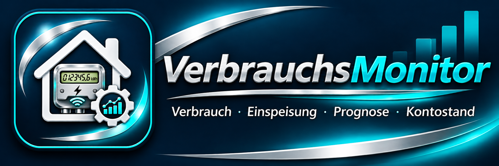
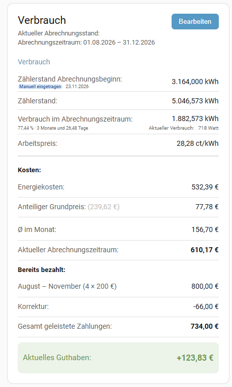
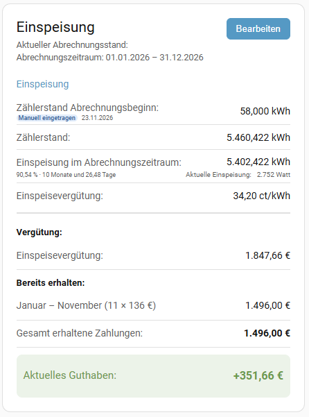
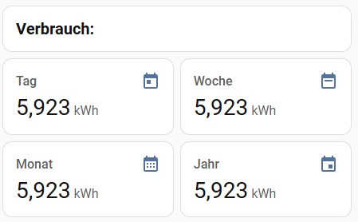
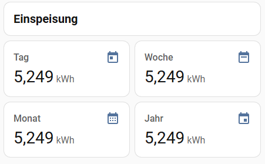

  

  <a href="#funktionen">Funktionen</a> ·
  <a href="#screenshots">Screenshots</a> ·
  <a href="#installation">Installation</a> ·
  <a href="CHANGELOG.md">Changelog</a> ·
  <a href="docs/">Dokumentation</a> ·
  <a href="https://github.com/Muschelschubser26/HA-Integration-VerbrauchsMonitor/issues">Fehler melden</a>

<h1 align="center">VerbrauchsMonitor</h1>

  <strong>Stromverbrauch, Einspeisung, Abrechnung und Energie-Forecast direkt in Home Assistant im Blick.</strong> 
  Lokale Datenhaltung · Deutsche und englische Oberfläche · Keine Cloud-Telemetrie

  
  
  

Der **VerbrauchsMonitor** ist eine Custom Integration für Home Assistant zur lokalen Verwaltung und Auswertung von Stromzählern. Er verbindet Messwerte für Verbrauch und Einspeisung mit Vertrags- und Tarifdaten, Abrechnungszeiträumen, Zahlungen, Kontoständen und Energieprognosen.

**Repository:** [Muschelschubser26/HA-Integration-VerbrauchsMonitor](https://github.com/Muschelschubser26/HA-Integration-VerbrauchsMonitor)  
**Domain:** `verbrauchsmonitor`  
**Produktivversion:** `0.0.1`  
**Entwicklungsbasis:** `0.0.2-beta.1` · interne Revision `R0171`  
Frühere Beta-Stände, darunter Beta R161, sind im Changelog dokumentiert.

Die Verarbeitung und Speicherung erfolgen lokal in Home Assistant. Die Integration initiiert keine Cloud-Kommunikation und sendet keine Telemetrie.

---

## Funktionen

| Zähler und Messwerte | Verträge und Abrechnung |
|:--|:--|
| Verbrauchs- und Einspeisezähler | Verträge, Tarife und Abrechnungszeiträume |
| Tages-, Wochen-, Monats- und Jahreswerte | Monatsabschläge und einzeln änderbare Monatsbeträge |
| Aktuelle Leistung und Energieverläufe | Buchungen, Zahlungen und Kontostände |
| Mehrere logische Zähler und Richtungen | Abrechnungs- und Prognoseübersichten |

| Prognose und Zuverlässigkeit | Datenverwaltung |
|:--|:--|
| Verbrauchs- und Einspeiseprognosen | Lokale SQLite-Datenbank |
| Saison-, Tageszeit- und Sonnenpositionsbezug | Datenbankinformationen und Sicherungsgrundlagen |
| Getrennte Bewertung für Verbrauch und Einspeisung | Recorder-Entitäten als YAML exportieren |
| Transparente Zuverlässigkeitsanzeige | Migrations- und Diagnoseinformationen |

## Screenshots

Die folgenden Ansichten stammen aus Home Assistant und zeigen die Karten des VerbrauchsMonitors.

<table>
  <tr>
    <td width="50%" align="center">
      
       <strong>Verbrauchszählerkarte</strong>
    </td>
    <td width="50%" align="center">
      
       <strong>Einspeisezählerkarte</strong>
    </td>
  </tr>
  <tr>
    <td width="50%" align="center">
      
       <strong>Summenzähler – Verbrauch</strong>
    </td>
    <td width="50%" align="center">
      
       <strong>Summenzähler – Einspeisung</strong>
    </td>
  </tr>
</table>

## Installation

### Voraussetzungen

- Home Assistant Core **2026.11.1 oder neuer**
- Mindestens ein gültiger Quellzähler als Home-Assistant-Sensor
- Für historische Prognosegrundlagen: verfügbare Recorder-Historie bzw. Langzeitstatistiken

### Installation über HACS

1. HACS öffnen und zu **Integrationen** wechseln.
2. Über das Menü **Benutzerdefinierte Repositories** öffnen.
3. Repository-URL eintragen:  
   `https://github.com/Muschelschubser26/HA-Integration-VerbrauchsMonitor`
4. Kategorie **Integration** auswählen und hinzufügen.
5. Nach „VerbrauchsMonitor“ suchen und die Integration installieren.
6. Home Assistant vollständig neu starten.
7. Unter **Einstellungen → Geräte & Dienste → Integration hinzufügen** den VerbrauchsMonitor auswählen und konfigurieren.

### Manuelle Installation

1. Vor Änderungen ein vollständiges Home-Assistant-Backup erstellen.
2. Den Ordner `custom_components/verbrauchsmonitor/` aus diesem Paket vollständig nach `/config/custom_components/verbrauchsmonitor/` kopieren. Den alten Integrationsordner vollständig ersetzen, nicht Dateien zusammenführen.
3. Home Assistant vollständig neu starten.
4. Den VerbrauchsMonitor unter **Einstellungen → Geräte & Dienste** hinzufügen bzw. konfigurieren.
5. Nach dem Neustart das Dashboard neu laden.

Details und Updatehinweise stehen in der [Installations- und Updateanleitung](docs/INSTALLATION.md).

## Wichtige Hinweise

- Monatsabschläge können je Monat einzeln bearbeitet werden. Der laufende Vertragsabschlag wird dadurch nicht automatisch fortgeschrieben.
- Die Auswahl für zukünftige Monatsbeträge beginnt beim nächsten Monat und umfasst höchstens sieben zulässige Monate. Jahreswechsel werden berücksichtigt; die Änderung gilt innerhalb des Abrechnungszeitraums bis zu dessen Ende.
- Die Zuverlässigkeitsanzeige basiert auf tatsächlich verfügbaren historischen Daten. Bei unzureichender Recorder-Historie wird kein künstlicher Prozentwert erzeugt.
- Die Zuverlässigkeit ist eine datenbasierte Einschätzung und keine Garantie für die Höhe einer späteren Abrechnung.

## Dokumentation und Support

- [Installations- und Updateanleitung](docs/INSTALLATION.md)
- [Architektur](docs/ARCHITEKTUR.md)
- [Anforderungen](docs/ANFORDERUNGEN.md)
- [Datenbankmigration](docs/DATENBANK_MIGRATION_R169.md)
- [Zuverlässigkeitsmodell](docs/ZUVERLAESSIGKEIT.md)
- [Changelog](CHANGELOG.md)
- [Offene Punkte und Laufzeitprüfungen](docs/OFFENE_PUNKTE.md)
- [Fehler melden / Fragen stellen](https://github.com/Muschelschubser26/HA-Integration-VerbrauchsMonitor/issues)

---

## ☕ Entwicklung unterstützen

Gefällt dir der VerbrauchsMonitor und hilft dir die Integration bei der Übersicht über deinen Energieverbrauch?

Wenn du die Weiterentwicklung unterstützen möchtest, freue ich mich über einen Kaffee. Deine Unterstützung hilft dabei, neue Funktionen zu entwickeln, Verbesserungen umzusetzen und die Integration weiter zu pflegen.

  

  Vielen Dank für deine Unterstützung! ❤️

---

  <strong>VerbrauchsMonitor</strong> 
  Smarte Energieübersicht – lokal in Home Assistant.

